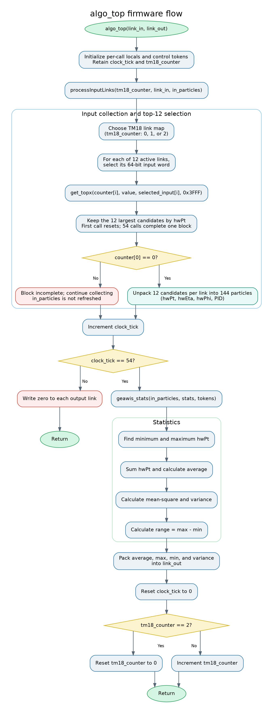

# L1 TEST PROJECT

<p align="center">
    
</p>

## Overview

CMS Level-1 trigger processes data every LHC bunch crossing of 25ns. However, some systems are time multiplexed to provide additional time for processing using multiple cards. The Correlator Layer 1 (CL1) is time multiplexed at 18, much like the track trigger and the HGCAL trigger primitives systems, whereas the Correlator Layer 2 (CL2) operates time-multiplexed at 6.

### Correlator Layer 2 (CL2)

CL2 takes in puppi candidates and produces physics output. Since the CL2 input is coming from CL1, which operates time-multiplexed at 18, there are three TM18 slices processed per board in CL2.


### `algo_top` Architecture

The input to the CL2 are 32 25-Gbps links of barrel and hadron calorimeter data, of which 12 links are active for each TM6 interval. There are six more eGamma puppi candidate links that provide lower threshold objects, which are currently ignored here. The 32 links are organized in this setup as:

```
// TM18_01: B(00, 01, 02, 03, 04, 05), HE(06, 07), HFWD(08, 09), HF(30, 31)
// TM18_07: B(10, 11, 12, 13, 14, 15), HE(16, 17), HFWD(18, 09), HF(30, 31)
// TM18_13: B(20, 21, 22, 23, 24, 25), HE(26, 27), HFWD(28, 29), HF(30, 31)
```

The block `algo_top:processInputLinks` first selects one of above three sets of links in each TM6 interval that it processes. The other five identical cards handle (TM18_02, TM18_08, TM18_14), etc.

Since `algo_top` gets input data every clock-tick of 360 MHz clock, it gets 9 64-bit candidates in one LHC bunch crossing, i.e., 9x6=54 candidates in the TM6 time interval. Total count of objects received aggregated over all 12 active links are 54x12 = 648.

For each TM6 interval, the second part of ``processInputLinks`` keeps the 12 highest-pT candidates from each of the 12 selected links, reducing the list to 12x12 = 144 particles. The selected link group rotates among TM18_01, TM18_07 and TM18_13 on successive 54-cycle intervals. (Note that the ``deregionizer`` implemented by the CL2 team reduced even more to 128 candidates).

The main algorithm playground to process puppi candidates is `geawis`

The goal is to implement a Global Event Analysis (GEA) system that digests these 144 puppi candidates using an ML-based algorithm to create a(some) score(s) to classify the event. The score(s) for each event can be forwarded to the L1 Global Trigger, every bunch crossing, i.e. TM1, which can take a decision on the status of the event.

### Example algorithm: `StatsAlgo` Architecture

This block directly receives 144 PUPPI candidates and control token, and produces a Stats object, which contains average, variance, etc. This is just a test block which needs to be replaced with a useful algorithm.

## Simulation
The setup is trivial - it simply generates a dataset with random values distributed uniformly and sends it to Vitis.

### 1. Setup `geawis`
The first step is to set up geawis.
```
git clone git@github.com:SridharaDasu/geawis.git
cd geawis
```

### 2. Run csim to verify that the testbench "simulation" agrees with the code used to make the "RTL".

In this step we run C simulation using Vitis 2025.2. Compiling requires access to datatypes.h, which is in CMSSW area. If you are working on a machine with /cvmfs it should work fine. Load the local CMS and Vitis environment, then invoke `vitis-run`. `GEAWIS_NEVENTS` sets the number of events; `GEAWIS_INPUT` optionally selects a CSV input file. Leave `GEAWIS_INPUT` unset to use random input.
```
source ./setup.sh
GEAWIS_NEVENTS=1000 vitis-run --mode hls --tcl run_csim.tcl
GEAWIS_NEVENTS=1000 GEAWIS_INPUT=data/minbias.csv vitis-run --mode hls --tcl run_csim.tcl
```
To directly test the fixed-point statistics against the software reference, run:
```
GEAWIS_NEVENTS=1000 vitis-run --mode hls --tcl run_csim_geawis.tcl
GEAWIS_NEVENTS=1000 GEAWIS_INPUT=data/minbias.csv vitis-run --mode hls --tcl run_csim_geawis.tcl
```
The same environment variables configure C/RTL co-simulation:
```
GEAWIS_NEVENTS=1000 GEAWIS_INPUT=data/minbias.csv vitis-run --mode hls --tcl run_cosim.tcl
```
`run_csim_topx.tcl` and `run_csynth.tcl` do not read event or input data, so these variables do not affect them.

To run the tau finder over generated CSV events, compile and pass one or more files (the shell expands `data/*.csv`):
```
source ./setup.sh
c++ -I"$XILINX_HLS/include" -I"$CMSSW_BASE/src" -I./ tb_geawis_taus_external.cpp firmware/geawis.cpp -o tb_geawis_taus_external
./tb_geawis_taus_external data/minbias.csv
./tb_geawis_taus_external data/*.csv
```
The testbench reports each found tau, including its mother particle ID, and summarizes the number of events and taus per input file. It skips stale `*-128.csv` files; events with fewer than `NPARTICLES` rows are zero-padded.

The tau finder tests signal-cone radii 0.20, 0.15, and 0.10 around each
charged seed and keeps the widest valid one- or three-prong hypothesis with
unit charge. This collects wider decays while recovering compact cores when
extra tracks invalidate a larger cone. Overlapping hypotheses compete by
reconstructed pT so a signal constituent cannot appear in two output taus.
Particles outside the selected core contribute to the R=0.4 isolation cone;
the finder applies no isolation cut. The function interface is unchanged.

Use `data/hllhc-z-tau.csv` to check seed/clustering recovery before isolation.
Regenerate older CSVs with the corrected data generator first: their `motherid`
field mixes tau PDG IDs with unrelated parent indices, including index 15.
The ancestry audit and generation details are in [data/README.md](data/README.md).
For samples with `motherid = +/-15` ancestry tags, the external testbench also
reports how many event/ancestor pairs have a tagged output. It reports both
recovery without a pT cut and recovery above reconstructed pT=10 among tags
with a charged input and summed visible input pT above 10. Repeated outputs
with the same ancestor count only once. These are seed-ancestry diagnostics,
not a generated-tau efficiency: the 144-particle input can omit descendants,
and the CSV does not contain the generated tau four-vectors. Ancestry labels
are used only by the testbench, never to select or rank firmware candidates.

To make the tau histograms and eta-phi plots from its captured output, use the Python script with gnuplot:
```
source ./setup.sh
./tb_geawis_taus_external data/*.csv > tau_run.log
python3 tau_plots/plot_tau_output.py tau_run.log
```
The script writes two SVG dashboards per CSV (all printed taus and those with relative isolation below 10%), each with an eta-phi scatter plot and a mother particle ID histogram, plus histogram data files and the generated gnuplot script in `tau_plots/` by default. The testbench prints taus with pT above 10 and reports relative isolation as cone energy divided by reconstructed tau pT. For another simulation dataset, pass its CSV file(s) to the testbench, capture the output to a log, then pass that log to the Python script. Choose a different plot destination with `--output-dir`.

### 3. Generate "RTL"

This generates the firmware RTL, which is to be used with the core framework to produce a bitfile eventually.
```
source ./setup.sh
vitis-run --mode hls --tcl run_csynth.tcl
```

### 4. Generate "bit file"

One needs to setup submodules directory APx core firmware following Ales Svetek's instructions. 

One needs to copy the generated RTL from step 3 to targets/xF13P/rtl/AlgoRTL/.

One can then run

```
source ./setup.sh
cd targets/xF13P/
make
```
The bitfile generation could take several hours.
