# Pythia8 and UltraFastSim based puppi candidate data generator

## Build instructions
The main program to use is generateData. You can build it using the following commands.
```
source /afs/hep.wisc.edu/cms/sw/Xilinx/Vivado/2023.1/settings64.sh
source /cvmfs/cms.cern.ch/cmsset_default.sh; pushd /cvmfs/cms.cern.ch/el9_amd64_gcc12/cms/cmssw/CMSSW_15_1_2/src; cmsenv; popd
make
```

## Input setup examples
The minbias.cards and hlhc-z.cards are setup to simulate proton-proton
collisions at 13.6 TeV. These are Pythia8 data cards. You can generate
other types of signal events with the program as long as Pythia8
understands those files.

One can make minbias events with minbias.cards:

```
generateData minbias.cards
```

One can make plots using:

```
root -b -l makePlots.cpp\(\"minbias.root\"\)
```

The output of generateData program, using any of the <tag>.cards files are
the files <tag>.csv with 144  puppi candidates per event and <tag>.root
with histograms of those quantities.

## Tau ancestry checks

After generating the hard event, `TauAncestry.h` collects all descendants of
every tau, including intermediate tau copies and subsequent hadron decays,
before repurposing `mother2`. The stored value is the ancestor's signed PDG
ID (`15` or `-15`); all other particles get zero. Pileup particles are appended
with both parent indices cleared because those indices refer to a different
event. Pileup tau decays are intentionally not tagged as hard-process taus.
Pythia mother-history queries must precede this conversion.

`UltraFastSim` copies the tag into ROOT's second-mother field, preserves it
through smearing and sorting, and `EventAnalysis` writes it to CSV `motherid`.
The tag identifies an ancestor species/sign, not a unique generated tau when
an event contains additional tau pairs. Existing CSVs retain the old mixed
encoding: even `motherid = 15` can be a background mother index. Regenerate
them before using these tags as truth labels or quoting recovery efficiencies.

To check the entire path against the original, unmodified Pythia mother graph:

```
source ../setup.sh
make test-tau-ancestry OPT2=-O2
```

The test checks tau-copy and multigeneration decay fixtures, a background
mother at event index 15, signed-tag conversion, pileup, smearing, sorting,
and the visible-tau four-vector sum. It reports tag coverage before detector
cuts, after pT > 1 GeV and |eta| < 5, and after keeping the 144 leading particles.
For a shorter run or no pileup, build `tb_tau_ancestry` and run, for example,
`./tb_tau_ancestry hllhc-z-tau.cards 100 0` (arguments: cards, events, mean pileup).
The test does not overwrite generated CSV or ROOT files.

Both `hllhc-z*.cards` files set `PhaseSpace:mHatMin = 50 GeV`, requiring a
generated dilepton mass above 50 GeV. Older samples used the 4 GeV default
and contain many soft taus; regenerate them to apply the new cut. Two
generated taus per event still does not imply two visible tau clusters above
10 GeV, even with complete ancestry tagging.

You can use minbias data to learn about the backgrounds. Hopefully, the
anomaly detection algorithm can be used to distinguish the backgrounds from
any type of signal.

Histograms from ttbar.root, hllhc-z.root and minbias.root:

<p align="center">
    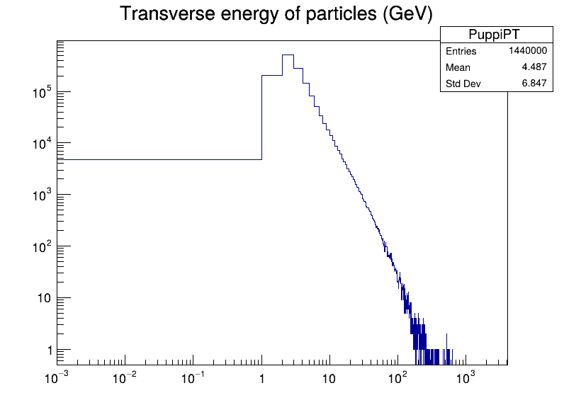
    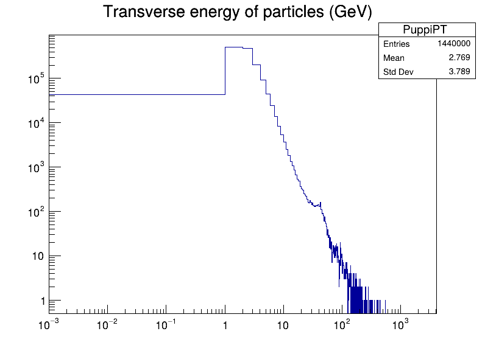
    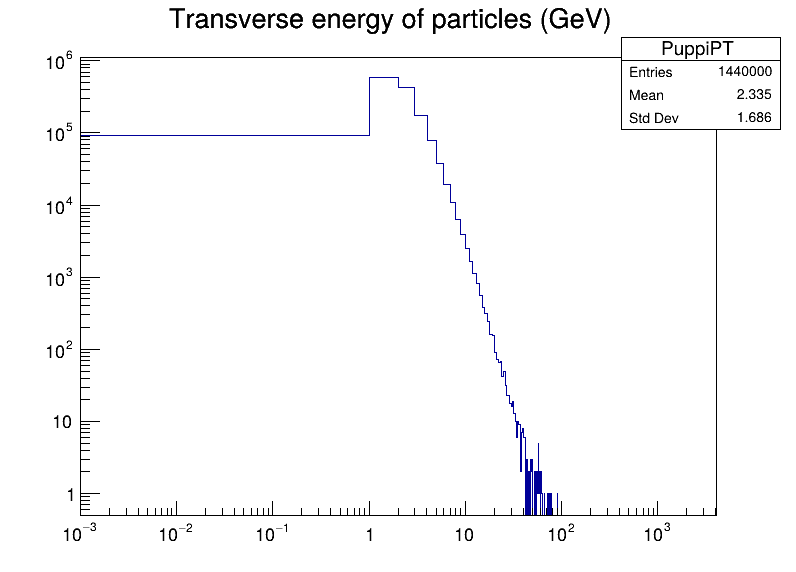
</p>
<p align="center">
    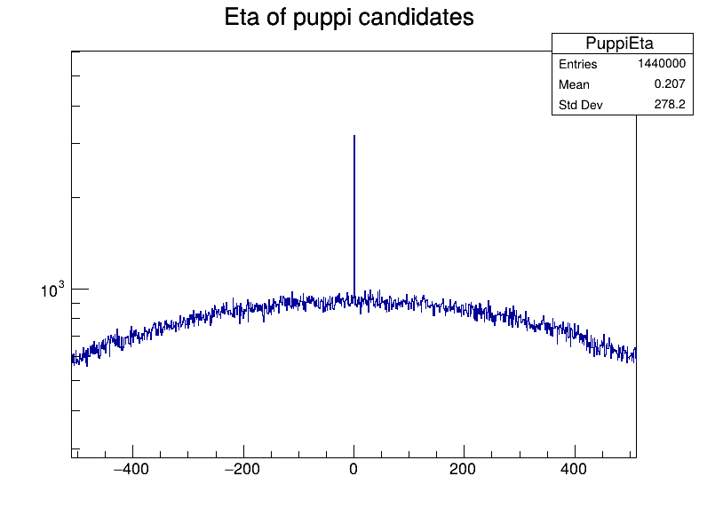
    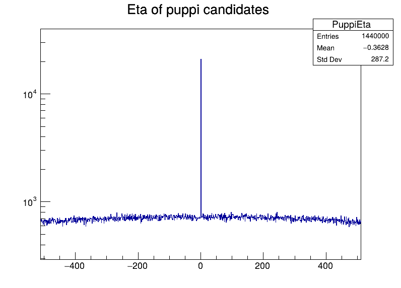
    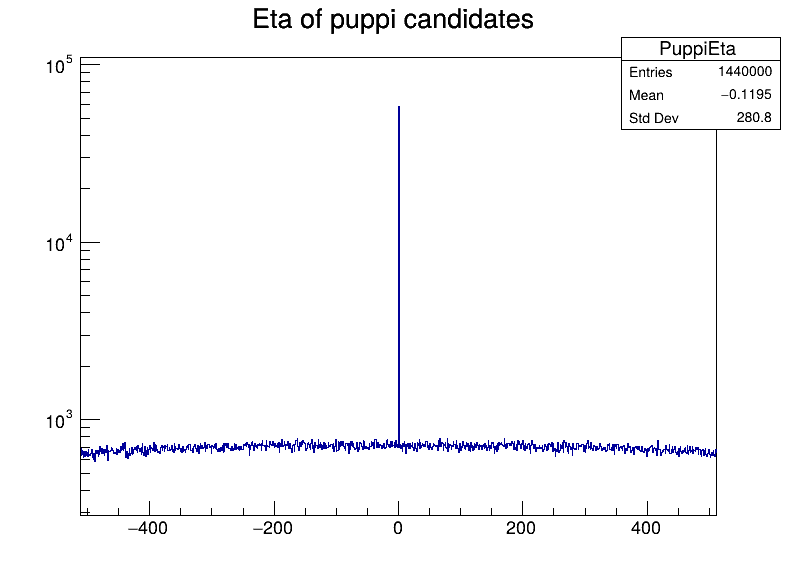
</p>
<p align="center">
    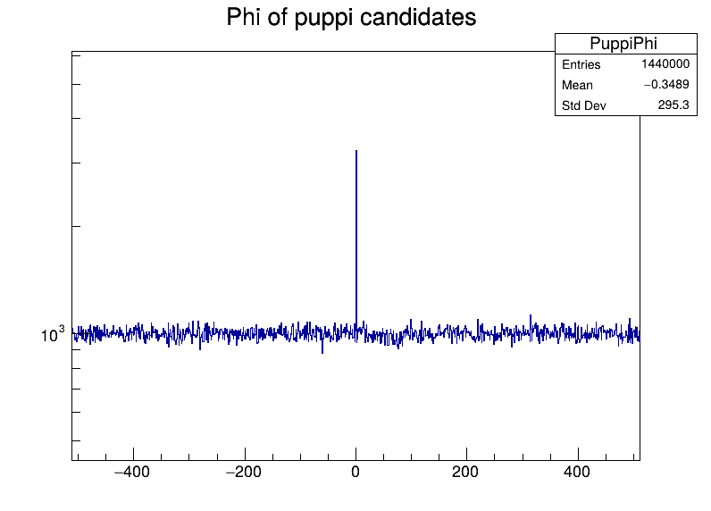
    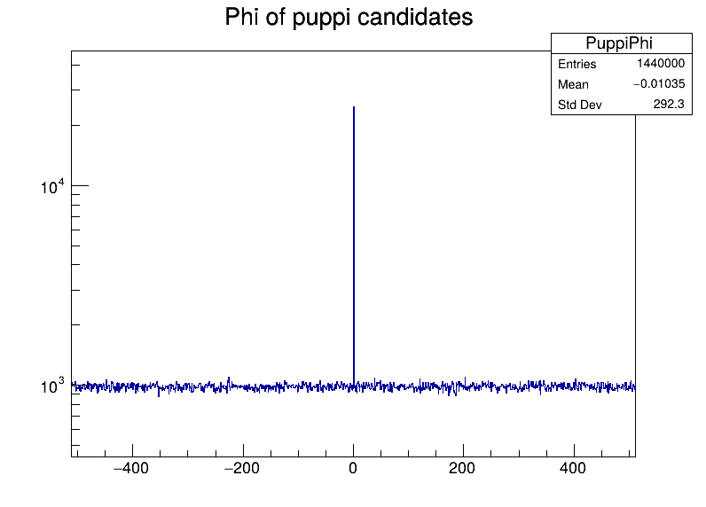
    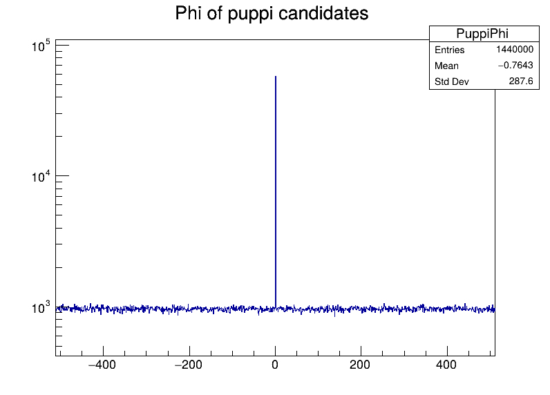
</p>
<p align="center">
    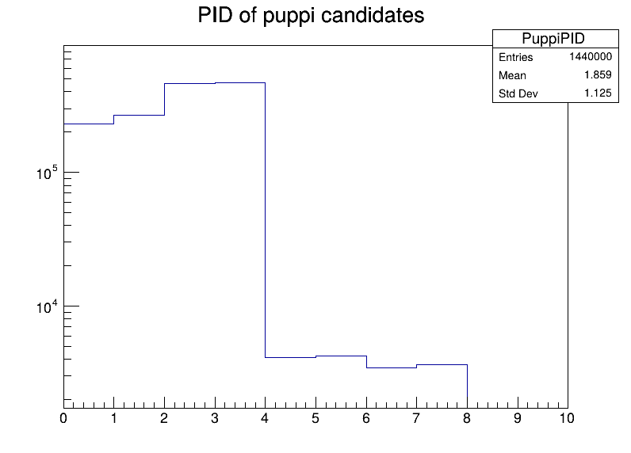
    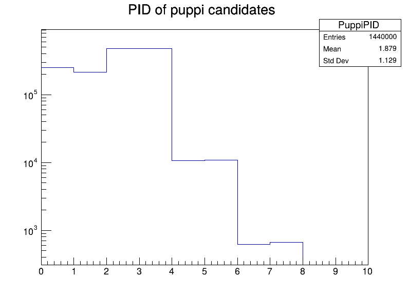
    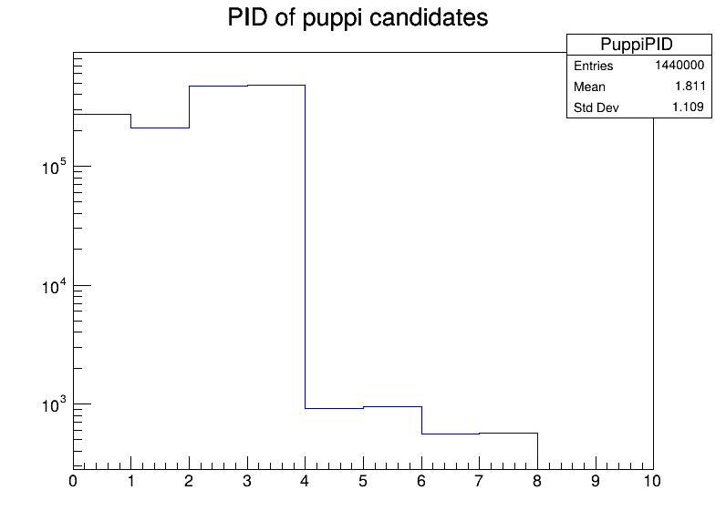
</p>
